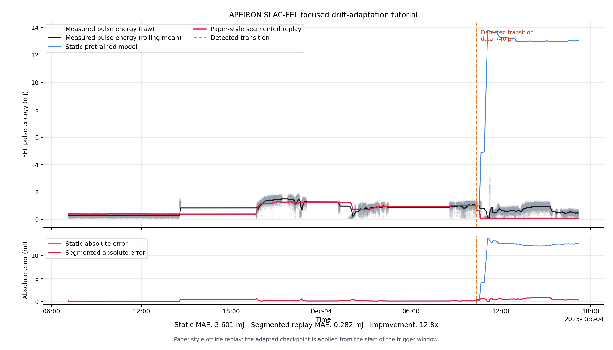

# SLAC-FEL Scientific Example

This example applies Apeiron to measured data from the Linac Coherent Light
Source free-electron laser (LCLS FEL) at SLAC. It demonstrates how to monitor a
pretrained scientific surrogate, detect a change in its prediction error, and
adapt the model to the changed operating regime.

Unlike the computer-vision examples, this workflow does not manufacture drift
with image transformations. The stream consists of chronological accelerator
observations.

## What the Model Predicts

Each observation contains:

- 341 accelerator state and control readbacks used as model inputs.
- One measured FEL pulse-energy target,
  `GDET:FEE1:241:ENRC`, expressed in millijoules (mJ).
- A timestamp that preserves the experimental ordering.

The pretrained neural-network surrogate maps the 341 accelerator variables to
the measured pulse energy. As accelerator conditions change, the relationship
learned by the surrogate may become less accurate.

Apeiron monitors the model's mean absolute error (MAE). The focused tutorial
uses Page-Hinkley to identify a large error transition and then performs a
short online-EWC adaptation.

## Tutorial Scope

The focused tutorial uses 14 chronological files:

```text
data_730.pkl
data_731.pkl
...
data_743.pkl
```

Together they contain 70,000 observations from December 2 through December 4,
2025. The major transition begins in `data_740.pkl`.

The focused subset was selected because it provides:

- a stable pre-transition period;
- one clear detector event;
- a substantial loss of accuracy under the pretrained model;
- measurable recovery after adaptation;
- a short CPU runtime;
- deterministic results under seed 42.

The full December paper-reproduction configuration remains available at
`test_tomls/dec2025.toml`, but it is not required for this tutorial.

## Repository Contents

```text
examples/slac_fel/
├── README.md
├── __init__.py
├── model.py
├── utils.py
├── slac-fel-tutorial.toml
├── model/
│   ├── feature_config.yml
│   ├── final_lcls_fel_model.pt
│   ├── lcls_fel_input_scaler.pt
│   └── lcls_fel_output_scaler.pt
└── test_tomls/
    └── dec2025.toml
```

The pretrained model, feature definition, and scalers are included in the
repository.

## Data Availability

The permanent public hosting location for the focused dataset is still being
determined. Until that location is finalized, collaborators who already have
the data can place the 14 files in any local directory and provide that
directory at runtime.

The tutorial does not require a fixed filesystem layout or storage service.

## Run the Tutorial

From the repository root, first install the locked environment:

```bash
uv sync
```

Then run the tutorial:

```bash
uv run python -m src.main \
  --config examples/slac_fel/slac-fel-tutorial.toml \
  --set data.path=/path/to/fel-tutorial-data
```

Output paths may also be overridden:

```bash
uv run python -m src.main \
  --config examples/slac_fel/slac-fel-tutorial.toml \
  --set data.path=/path/to/fel-tutorial-data \
  --set model.ckpts_path=/path/to/run/checkpoints \
  --set logging.metrics_output_path=/path/to/run/metrics.csv
```
The supplied configuration runs on CPU and uses:

- seed 42;
- Page-Hinkley drift detection;
- a 10-observation detector warm-up;
- online EWC with historical replay;
- 200 adaptation updates;
- 13 stream updates after the initial window;
- detector reset after adaptation.

## Expected Result

A validated CPU run produces one drift event:

```text
DRIFT DETECTED (Event #1)
```

The event occurs while processing `data_740.pkl`. Apeiron then completes 200
continual-learning updates, saves `drift_adaptation_1.pt`, and resumes
monitoring through `data_743.pkl`.

The exact pipeline step is 31 with the supplied configuration. The complete
run should process all 14 files once, without wrapping back to the first file.

Typical artifacts are:

```text
output/slac-fel/tutorial/
├── metrics.csv
└── checkpoints/
    ├── drift_adaptation_1.pt
    └── latest
```

Runtime depends on the machine. The validated CPU workflow finishes in well
under one minute.

## Reproduce the Figure

The focused paper-style replay is summarized below:



The blue curve shows the original pretrained surrogate. The red curve uses
the pretrained model before the detected transition and the adapted checkpoint
from the beginning of the trigger window. The lower panel shows the
corresponding rolling absolute error.

This is an offline segmented replay aligned with the paper analysis. It is
not a strict causal replay because the adapted checkpoint becomes available only
after the trigger window has been processed.

Regenerate the figure after completing the tutorial run:

```bash
uv run python -m examples.slac_fel.plot_tutorial \
  --data /path/to/fel-tutorial-data \
  --checkpoint output/slac-fel/tutorial/checkpoints/drift_adaptation_1.pt \
  --output examples/slac_fel/figures/focused_drift_adaptation.png
```
## Interpreting the Result

The tutorial demonstrates a real tradeoff rather than universal improvement.

Across the changed regime, the static pretrained model has approximately
12.33 mJ MAE, while the adapted checkpoint has approximately 0.61 mJ MAE.
Adaptation therefore provides a large improvement after the transition.

However, replaying the adapted checkpoint on the earlier stable regime
increases MAE from approximately 0.16 mJ to 0.55 mJ. The update improves the
new regime but does not preserve all historical behavior.

This distinction is central to trustworthy adaptation:

- a drift alert indicates statistical evidence of change;
- it does not establish the physical cause of that change;
- adaptation can improve current performance while degrading prior regimes;
- operational deployment may require additional scientific or safety checks
  before an update is accepted.

The example labels the event only as a detected change. It does not classify
the accelerator condition as normal, anomalous, unsafe, or adversarial.

## How the Example Connects to Apeiron

`model.py` implements the `BaseModelHarness` interface for the FEL surrogate.
It is responsible for:

- loading the pretrained neural network and scalers;
- reading the chronological pickle files lazily;
- creating train, validation, stream, and replay loaders;
- converting scaled prediction error back to millijoules;
- constructing the optimizer used during adaptation.

`utils.py` handles feature configuration, scaler loading, numeric file
ordering, and time-window construction.

`slac-fel-tutorial.toml` contains the focused experiment parameters. The
external data location is supplied with `--set data.path=...`, so the tutorial
does not depend on a particular storage service or filesystem layout.

## Implementation Provenance

The FEL harness and December reproduction configuration were ported from
APEIRON commit
`5542efbb47fdfddbb0b3202beaa2ad4c68cc3bd2`, committed by Sara Miskovich
during the original SLAC-FEL paper-reproduction work.

The feature configuration, pretrained model, and input and output scalers are
retained unchanged from that source commit. The focused configuration,
current-main compatibility updates, tests, documentation, and replay figure
were added for this tutorial.

## Full December Reproduction

The full configuration is:

```text
examples/slac_fel/test_tomls/dec2025.toml
```

It expects 150 files, `data_699.pkl` through `data_848.pkl`.
